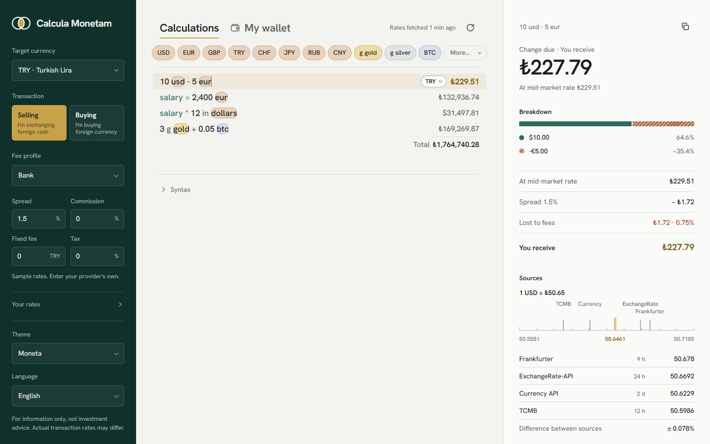
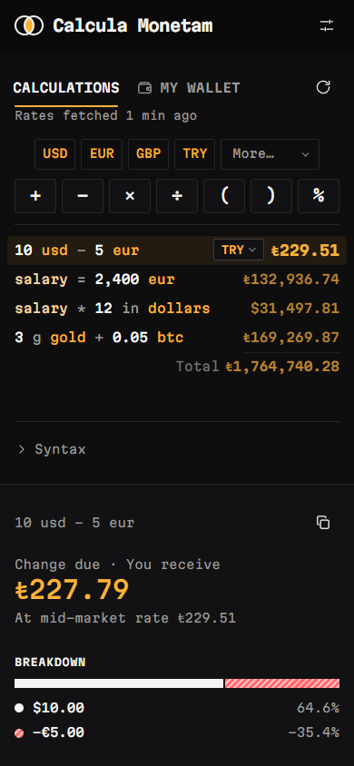

# Calcula Monetam

**Do math across currencies in one line.** Most converters turn one currency into another. Calcula Monetam adds and subtracts them:

```
10 usd - 5 eur + 3 g gold             → TRY
salary = 2,400 eur
salary * 12 - 9,000 usd in gbp        → GBP
1,000 eur in quarter gold             → Turkish gold coins
```

Rates are the median of five free sources, and every result also shows what you **actually get** after spread, commission, fixed fee and tax.

**[Open the app →](https://emirhan76demir.github.io/calcula-monetam/)** · No install, no account, no ads, works offline · [Türkçe](README.tr.md) · [User guide](GUIDE.md)





## Why

- **Mixed currencies in one line:** `10 usd - 5 eur`, `salary * 12 in usd`, `3 g gold + 0.05 btc`, variables, percentages.
- **Honest rates:** median of Frankfurter (ECB), ExchangeRate-API, Currency API, Gold API and the Central Bank of Türkiye, with every source and its age shown.
- **Real-world net:** spread, commission, fixed fee and tax for banks, exchange offices, card payments and crypto exchanges — or your own institution rate.
- **Work backwards:** `10,000 try net in usd` tells you how much to exchange to receive an exact amount.
- **Gold, silver and Turkish gold coins**, a travel **wallet**, 5 themes, 10 languages, installable PWA.

<br clear="right">


## Use

- Open `index.html`. No install, server or build step.
- To share it, copy the folder as is.
- Hosted on any static host (GitHub Pages, Netlify, Cloudflare Pages), it can be installed as an app and works offline.

## Writing

| You type | Meaning |
|---|---|
| `10 usd`, `$10`, `10 dollar`, `10 доллар`, `10美元` | Codes, symbols or names in 10 languages |
| `+ - * / ( )` | Arithmetic |
| `250 eur + 18%`, `250 eur - 10%` | Add or subtract a percentage |
| `1500 try in usd`, `→ gbp` | Target currency at the end of a line |
| `3 g gold`, `1 oz silver` | Gold and silver by gram or troy ounce |
| `3 çeyrek + 1 yarım altın`, `10 g 22 ayar` | Turkish gold coins and karat gold |
| `10,000 try net in usd` | Reverse: currency needed, or affordable, for a net amount |
| `salary = 2,400 eur` | Variable (via **+ Variable**), usable on later lines |
| `hotel: 120 eur` | Labelled line |
| `# Trip budget` | Note or heading line (via **+ Note**) |
| `10k usd` | 10,000 |

Numbers follow the selected language's format.

You don't have to type units. The **quick buttons** above the editor insert one at the caret; the ones you use most move to the front. **Autocomplete** suggests currencies and your variables after a couple of letters (arrow keys, then Enter or Tab). A **spelling check** stops you from continuing after an unrecognised word (`dolr`) and lists the likely fixes; nothing is ever corrected without your choice.

## Fees

**Selling** subtracts costs and shows what you receive. **Buying** adds them and shows what you pay.

- **Spread:** total buy/sell gap; half applies in your direction.
- **Commission:** percentage.
- **Fixed fee:** per transaction, in the target currency.
- **Tax:** percentage of the gross amount.

Fees apply only to the part converted into the target currency. Preset values are examples.

## My wallet

The **My wallet** tab tracks the cash you hold, currency by currency: **Add** at the start, **Spend** as you pay. It shows the total value, what's left in each currency and a dated activity log. It's built for keeping track of your money while travelling.

## Your rates

Enter your bank's or exchange office's rate under **Your rates** (e.g. `1 USD = 49.80 TRY`). It applies only to that pair and its inverse; the spread counts as included, while commission, fees and tax still apply. **Set your rate** in the Sources section adds the pair you are looking at.

## Sources

| Source | Content | Updated |
|---|---|---|
| [Frankfurter](https://frankfurter.dev) | European Central Bank data, history | Daily on working days |
| [ExchangeRate-API](https://www.exchangerate-api.com) | 160+ currencies | Daily |
| [Currency API](https://github.com/fawazahmed0/exchange-api) | Fiat, gold, silver, crypto | Daily |
| [Gold API](https://gold-api.com) | Gold and silver (troy ounce, USD) | Within minutes |
| [Central Bank of Türkiye](https://www.tcmb.gov.tr) | Official TRY rates | Working days, via GitHub automation (below) |

Free sources are not live market data. Each source's value and age is shown.

## How Central Bank of Türkiye rates arrive

The Central Bank of Türkiye (TCMB) does not let browsers read its rate file, so the app never contacts it directly. It reads `data/tcmb.js` inside the project instead. That file always ships with the app, so it also works when `index.html` is opened from disk.

On GitHub, the `.github/workflows/tcmb.yml` job fetches the TCMB file every working day at 12:45 and 14:15 UTC. `scripts/tcmb.mjs` validates it and, if it changed, commits it as `data/tcmb.js`. No server, account or key is involved; the job can only write to its own repository and uses no third-party actions.

Validation:

- Is the file in the expected format, dated within the last 10 days?
- Does it have at least 10 currencies including USD and EUR, with consistent buy and sell values?
- Did USD/TRY move more than 25% since the last record? If so, nothing is saved.

The app adds two more safeguards. TCMB data older than 5 days is not used, and any value more than 5% away from the other sources is left out of the median.

To run the job now, open **Actions → TCMB kurları → Run workflow** on GitHub. Without GitHub, `node scripts/tcmb.mjs` does the same on your computer.

Optionally set `tcmbUrl` in `js/config.js` to the file's public address (e.g. `https://raw.githubusercontent.com/USER/calcula-monetam/main/data/tcmb.js`) so copies opened from disk always use the latest TCMB data.

## Open via URL

Query parameters open the app with a ready calculation:

- `?q=` expression placed on the first line of the editor (up to 500 characters). It does not overwrite your saved worksheet; your first edit makes it yours.
- `?to=` target currency (e.g. `TRY`, `EUR`).
- `?lang=` interface language: `tr`, `en`, `ru`, `zh`, `es`, `de`, `fr`, `ar`, `ja`, `pt`. It is remembered only if you have not picked a language before; otherwise it applies to that visit only.
- `?theme=` theme (e.g. `tabula`).

Examples:

```
https://emirhan76demir.github.io/calcula-monetam/?q=10 dollars - 5 euro&to=USD&lang=en
https://emirhan76demir.github.io/calcula-monetam/?q=10+dollars+-+5+euro&to=USD&lang=en
https://emirhan76demir.github.io/calcula-monetam/?q=3%20g%20gold%20%2B%200.05%20btc&lang=en
https://emirhan76demir.github.io/calcula-monetam/?lang=de&theme=pura
```

`+` means a space; write `%2B` for an addition sign. After `q` and `to` are applied they are removed from the address bar, and the tab title shows `expression = result`.

## Search from the address bar

The app publishes an OpenSearch description (`opensearch.xml`). In Chrome, visit the site once, then type the site name in the address bar and press **Tab** to calculate directly. If it is not added automatically, add it under **Settings → Search engine → Manage search engines and site search** with the URL `https://emirhan76demir.github.io/calcula-monetam/?q=%s`.

## Search engines

`sitemap.xml` lists the home page and its ten language versions (`?lang=`). GitHub Pages project sites serve `/robots.txt` only at the user root, so the live `robots.txt` (pointing to this sitemap) and `llms.txt` are published from the [root site repository](https://github.com/emirhan76demir/emirhan76demir.github.io); the copies in this folder are for self-hosting. The site owner must verify the site in Google Search Console and submit `https://emirhan76demir.github.io/calcula-monetam/sitemap.xml` under **Sitemaps**.

## Themes and languages

Themes: Moneta, Tabula, Spectra, Tessera, Pura (also via `?theme=tabula`).
Languages: Türkçe, English, Русский, 中文, Español, Deutsch, Français, العربية, 日本語, Português.

## Privacy

Everything you type stays in your browser. The app only downloads rates from the sources above.

## Tests

```
node --test
```

## License

MIT. Fonts are under the SIL Open Font License 1.1 (`fonts/OFL-*.txt`).

---

For information only, not financial advice. Real transaction rates may differ.
